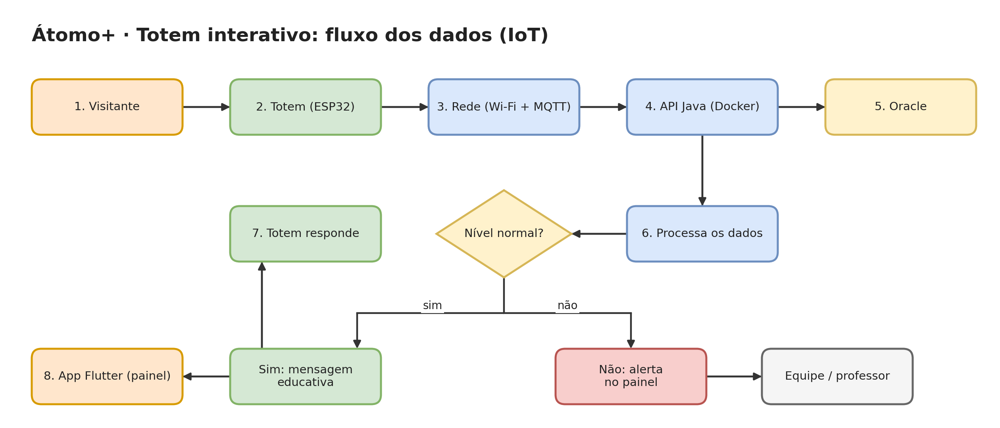

# Átomo+ - Proposta de IoT e Redes

**Challenge CTMSP 2026 - FIAP - Disruptive Architectures: IoT, IoB & Generative AI**

> Plataforma educativa que mostra que a energia nuclear vai muito além da destruição. Nesta Sprint 1, a proposta de IoT e Redes liga o conteúdo digital ao mundo físico por meio de um **totem interativo** com NFC e medição de radiação natural do ambiente.

| | |
| --- | --- |
| 🎥 **Vídeo (YouTube)| [Assistir à apresentação](https://www.youtube.com/watch?v=or0l9sq0SOk&t=9s) |
| 💻 **Repositório** | [GustavoSiciliano/Challenge_Sprint1_IoT_2026](https://github.com/GustavoSiciliano/Challenge_Sprint1_IoT_2026) |
| 📌 **Status** | Proposta **conceitual** (Sprint 1). O protótipo físico fica para as próximas sprints. |

---

## 👥 Integrantes

| Nome | RM | Turma |
| --- | --- | --- |
| Gustavo de Jesus Silva | 567926 | 2TDSPS |
| Gustavo Siciliano      | 568419 | 2TDSPS |
| Samuel Keniti          | 567614 | 2TDSPS |
| Manuel Pedro           | 567458 | 2TDSPS |
| Vinicius Morrone       | 566884 | 2TDSPS |

---

## 📚 Sumário

1. [Sobre o projeto Átomo+](#-sobre-o-projeto-átomo)
2. [Onde IoT e Redes entram](#-onde-iot-e-redes-entram)
3. [Descrição da aplicação](#-descrição-da-aplicação)
4. [Componentes](#-componentes)
5. [Comunicação](#-comunicação)
6. [Fluxograma](#-fluxograma)
7. [O que acontece com os dados](#-o-que-acontece-com-os-dados)
8. [Resposta e benefícios gerados](#-resposta-e-benefícios-gerados)
9. [Privacidade e segurança](#-privacidade-e-segurança)
10. [Tecnologias previstas](#-tecnologias-previstas)
11. [Roteiro de evolução](#-roteiro-de-evolução)
12. [Estrutura do repositório](#-estrutura-do-repositório)

---

## 🌍 Sobre o projeto Átomo+

### O problema

A maioria das pessoas associa tecnologia nuclear apenas a bombas, acidentes e radiação. Quase ninguém sabe que ela está presente em um exame de imagem, na esterilização de alimentos ou em um submarino que gera a própria energia. Falta um canal simples e divertido que faça essa ponte.

### A solução

O **Átomo+** é uma plataforma educativa (site + app) em que o usuário:

1. escolhe seu perfil e navega por conteúdos curtos sobre as áreas de aplicação da tecnologia nuclear;
2. tira dúvidas com um **assistente de IA** que responde no nível do perfil escolhido;
3. testa o que aprendeu em um **quiz com ranking**, dividido por faixa etária.

### Público-alvo

| Perfil | Faixa | O que precisa |
| --- | --- | --- |
| Criança | 8 a 12 anos | Linguagem lúdica, perguntas curtas, personagens |
| Jovem | 13 a 17 anos | Conteúdo de escola (Física, Química), desafio e competição |
| Adulto | 18+ | Dúvidas reais ("é seguro?", "onde isso me afeta?") e dados confiáveis |

### Áreas de aplicação abordadas

🏥 Saúde (radioterapia, medicina nuclear) · 🌾 Agricultura (irradiação de alimentos) · 🏭 Indústria (gamagrafia) · 🔬 Pesquisa · ⚡ Energia (Programa Nuclear da Marinha)

### Três funcionalidades principais

1. **Conteúdo por área de aplicação:** cards curtos e visuais.
2. **Quiz com ranking por categoria:** Criança, Jovem e Adulto, cada um com sua dificuldade.
3. **Assistente de IA:** chat que adapta a linguagem ao perfil do usuário.

### Diferencial

Mesmo conteúdo, três níveis de linguagem: criança e adulto aprendem sobre o mesmo tema, cada um no seu ritmo.

---

## 📡 Onde IoT e Redes entram

Um **totem interativo para escolas e museus** conecta o conteúdo digital ao mundo físico:

- O visitante aproxima uma **carteirinha NFC**; o totem identifica o perfil (criança, jovem ou adulto) e abre o quiz correspondente.
- Ao lado, um **contador Geiger-Müller** mostra a **radiação natural do ambiente**, provando na prática que a radiação existe em toda parte, em níveis seguros. Isso ataca direto o medo que o projeto quer reduzir.

### Necessidades atendidas

- Tornar a radiação algo **visível e compreensível**, em vez de abstrato.
- **Identificar o perfil** do visitante sem cadastro e sem digitar nada.
- Gerar **dados reais de uso e de leitura** para o painel do app.

---

## 🧩 Descrição da aplicação

O totem funciona como uma estação educativa autônoma:

1. O visitante chega e aproxima o cartão NFC.
2. O ESP32 lê o UID, gera um hash e informa o perfil à API.
3. O totem abre o quiz da categoria certa.
4. Em paralelo, o sensor Geiger mede continuamente a radiação de fundo e exibe a leitura com uma explicação simples (por exemplo: "isso é a radiação natural do granito e do ambiente; é seguro").
5. As leituras e as tentativas seguem para a nuvem e alimentam o painel do app.

---

## 🔧 Componentes

| Componente | O que faz | Onde fica |
| --- | --- | --- |
| **ESP32** | Microcontrolador com Wi-Fi: lê o NFC, conta os pulsos do Geiger e publica via MQTT | Dentro do totem |
| **Leitor NFC** (ex.: PN532) | Lê o UID da carteirinha e permite identificar o perfil | Frente do totem, na altura do visitante |
| **Módulo contador Geiger-Müller** (tubo GM com saída de pulsos) | Mede a radiação de fundo em contagens por minuto (CPM) | Lateral do totem, junto a amostras seguras (ex.: granito) |
| **Tela** (OLED ou tablet) | Mostra o quiz, a leitura atual e mensagens educativas | Frente do totem |
| **LED/buzzer** (opcional) | Feedback visual e sonoro de acerto/erro e de leitura | Totem |
| **Broker MQTT** (Mosquitto) | Recebe as mensagens dos totens | VM na Azure |
| **API Java** (Docker) | Valida, processa e grava os dados | VM na Azure |
| **Oracle** | Guarda leituras, tentativas e ranking | Banco da solução |
| **App Flutter** | Painel com gráfico das leituras, ranking e curiosidades | Celular da equipe e dos visitantes |

---

## 🔌 Comunicação

| Trecho | Meio / protocolo |
| --- | --- |
| Totem → nuvem | Wi-Fi do local + **MQTT** (leve, ideal para microcontrolador) |
| Broker → API | A API Java assina os tópicos e grava no Oracle |
| API → app | HTTP/REST (a mesma API do quiz) |

**Tópicos MQTT sugeridos**

```
atomo/totem/{id}/leitura   → contagens por minuto (CPM)
atomo/totem/{id}/nfc       → hash do UID do cartão
```

**Tolerância a falhas:** se o Wi-Fi cair, o ESP32 guarda as últimas leituras na memória e as reenvia quando reconectar.

---

## 🔄 Fluxograma



---

## 🗄️ O que acontece com os dados

1. O ESP32 conta os pulsos do Geiger em janelas de 60 segundos e calcula as **contagens por minuto**.
2. Publica a leitura e, quando há cartão, o **hash do UID NFC**.
3. A API calcula a **média móvel**, classifica o nível e grava no Oracle.
4. O totem recebe a resposta e o app atualiza o painel.

**Quem usa os dados**

| Quem | Para quê |
| --- | --- |
| Visitante | Ver a radiação do ambiente e jogar o quiz |
| Equipe do museu/escola | Acompanhar o painel e a saúde do totem |
| Equipe do projeto | Medir engajamento e identificar as perguntas mais erradas |

---

## ✅ Resposta e benefícios gerados

- **Atualiza o painel** do app com gráficos das leituras e ranking.
- **Abre o quiz certo** para o perfil identificado, sem cadastro.
- **Emite um alerta** quando a leitura fica acima da faixa esperada de calibração, pedindo ao monitor que cheque o sensor e o local.
- **Apoia a decisão** de quem opera o totem (manutenção, posicionamento, conteúdo mais acessado).
- **Educa:** transforma "radiação" de algo assustador em algo mensurável e compreensível.

---

## 🔒 Privacidade e segurança

- Guardamos apenas **contagens por minuto** e um **hash** do UID do cartão. Sem nome e sem dado pessoal, o que facilita a conformidade com a **LGPD**, inclusive para crianças.
- A comunicação MQTT deve usar **usuário/senha e TLS**; as credenciais ficam fora do repositório (variáveis de ambiente / `.gitignore`).
- O totem usa apenas **amostras seguras e isentas**. O contador de baixo custo mede o fundo natural; alimentos como a banana emitem pouco demais para esse tipo de sensor, então ficam como card educativo no conteúdo, não como medição ao vivo.
- Os **limiares de alerta** serão definidos após a calibração do sensor escolhido (a combinar com a AMAZUL e os professores).

---

## 🛠️ Tecnologias previstas

| Camada | Tecnologia |
| --- | --- |
| Dispositivo | ESP32 (C++/Arduino ou MicroPython), NFC (PN532), tubo Geiger-Müller |
| Mensageria | MQTT / Mosquitto |
| Backend | Java + Spring (API REST) |
| Banco de dados | Oracle |
| Infraestrutura | Docker, Azure (VM) |
| Aplicativo | Flutter |

---

## 🚀 Roteiro de evolução

| Sprint | Entrega |
| --- | --- |
| **1 (atual)** | Proposta conceitual de IoT e Redes, componentes, fluxograma e vídeo |
| **2** | Protótipo do totem (ESP32 + NFC + Geiger), integração MQTT ↔ API ↔ banco |
| **3** | Painel completo no app, assistente de IA integrado e métricas de engajamento |

---

## 📁 Estrutura do repositório

```
.
├── README.md            # Este documento
├── fluxograma.png       # Fluxograma em imagem
└── links.txt            # Links do YouTube e do GitHub
└── Iot_Sprint1.Pdf      # Documento do Projeto
```

---

**Átomo+ · Challenge CTMSP 2026 · FIAP**
